# Lab7Web_PHP — Pemrograman Server-Side dengan PHP

**Mata Kuliah:** Pemrograman Web (OBE)
**Modul:** Praktikum 7 — Pemrograman Server-Side dengan PHP
**Nama:** Rafif Mizanurohman
**NIM:** 312510377
**Kelas:** I252A

## Tujuan Praktikum

1. Memahami perbedaan pemrosesan client-side dan server-side.
2. Mengenali sintaks PHP dan menjalankan file PHP melalui server lokal.
3. Menggunakan variabel, tipe data, operator, percabangan, perulangan, dan function.
4. Menerima dan memproses data dari form HTML menggunakan metode GET dan POST.
5. Melakukan validasi dan sanitasi input dasar sebelum data ditampilkan atau diproses.
6. Membangun aplikasi sederhana yang menerima, memproses, dan menampilkan data pengguna.

## Perangkat

| Komponen | Keterangan |
|---|---|
| Laptop/PC | Windows, browser Chrome/Edge |
| Editor | Visual Studio Code |
| PHP | PHP 8.2.12 (XAMPP) |
| Web server | Apache (XAMPP) **atau** PHP built-in server (`php -S`) |
| Pengujian | Playwright/Chromium headless (60 pemeriksaan otomatis) |

## Struktur File

```
Lab7Web_PHP/
├── index.php              # beranda: tujuan, daftar latihan, ringkasan Latihan 1
├── latihan1.php           # Latihan 1 — menjalankan PHP
├── latihan2.php           # Latihan 2 — variabel, operator, percabangan (+ rata-rata)
├── latihan3.php           # Latihan 3 — perulangan dan array
├── latihan4.php           # Latihan 4 — function (diskon, luas, kelulusan, Rupiah)
├── latihan5.php           # Latihan 5 — form GET (pencarian + cari nama di array)
├── latihan6.php           # Latihan 6 — form POST (nama & prodi)
├── latihan7.php           # Latihan 7 — pengolahan data barang/harga/jumlah
├── miniproject.php        # Mini Project — form data mahasiswa (tampilan)
├── proses_mahasiswa.php   # pemrosesan & validasi mini project (dipisah dari tampilan)
├── fungsi_bantu.php       # fungsi bersama: formatRupiah(), aman()
├── partials/
│   ├── header.php         # kepala halaman + navigasi
│   └── footer.php         # kaki halaman
├── assets/
│   └── style.css          # tampilan seluruh halaman
├── screenshots/           # screenshot hasil pengujian
├── hasil_pengujian.txt    # rekapan 60 pemeriksaan otomatis
└── README.md
```

## Cara Menjalankan Server Lokal

**Cara A — XAMPP (sesuai modul)**

1. Jalankan XAMPP, start layanan **Apache**.
2. Salin folder `Lab7Web_PHP` ke `C:\xampp\htdocs\`.
3. Buka browser: `http://localhost/Lab7Web_PHP/`

**Cara B — PHP built-in server (tanpa XAMPP)**

```powershell
C:\xampp\php\php.exe -S localhost:8080 -t C:\xampp\htdocs\Lab7Web_PHP
# lalu buka http://localhost:8080/
```

> Jangan membuka file PHP dengan klik ganda — browser akan menampilkan kode mentah,
> bukan hasil eksekusi. Selalu akses lewat server lokal.

---

## Langkah Kerja dan Hasil

> Seluruh screenshot diambil dari browser headless (Playwright/Chromium) dengan interaksi nyata:
> mengisi form, menekan tombol, dan mengirim data. Seluruh halaman diuji otomatis:
> **60 pemeriksaan, semuanya PASS** (rincian di bagian *Hasil Pengujian Otomatis*).

**Tampilan beranda** (dibuka lewat `http://localhost/Lab7Web_PHP/index.php`):

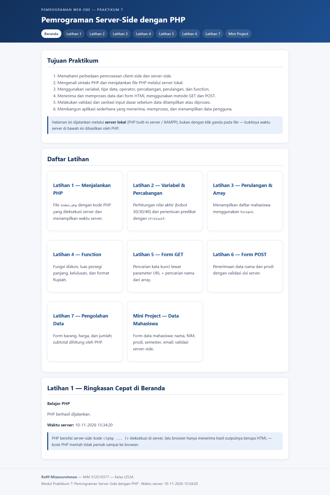

### Persiapan

1. Buat folder proyek `Lab7Web_PHP` di dalam repository `lab7Web`.
2. Siapkan file `index.php` dan jalankan lewat web server lokal.
3. Pisahkan tampilan (`partials/header.php`, `partials/footer.php`, `assets/style.css`)
   dari logika (`fungsi_bantu.php`, `proses_mahasiswa.php`).
4. Kerjakan latihan satu per satu dan periksa hasilnya di browser.

### Latihan 1 — Menjalankan PHP

`latihan1.php` menampilkan teks hasil `echo` dan waktu server dari `date()`. Karena file diproses
server, halaman browser hanya memuat HTML hasil proses — baris `<?php ... ?>` tidak pernah muncul
sebagai teks (dibuktikan otomatis: pemeriksaan *latihan1 kode PHP tidak bocor* PASS).

```php
<h1>Belajar PHP</h1>
<?php
  echo "<p>PHP berhasil dijalankan.</p>";
  echo "<p>Waktu server: " . date("d-m-Y H:i:s") . "</p>";
?>
```

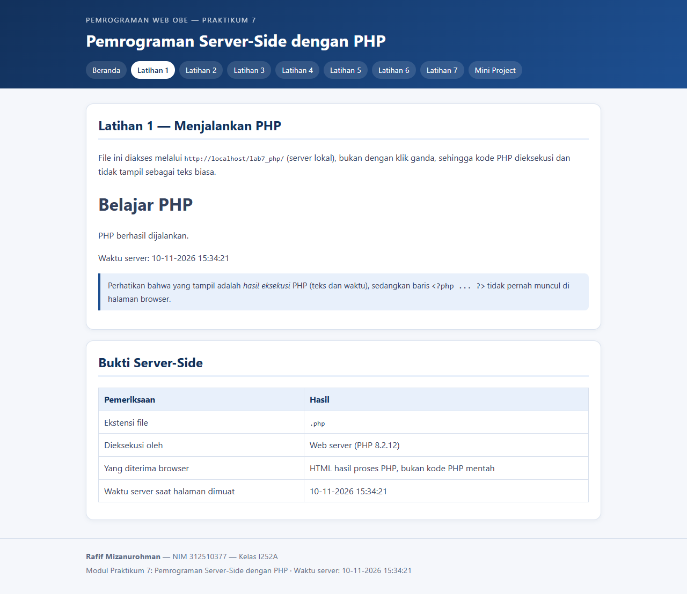

### Latihan 2 — Variabel, Operator, dan Percabangan

Nilai akhir dihitung dengan operator aritmetika (bobot 30/30/40), lalu predikat ditentukan dengan
`if/elseif/else`. Ditambahkan **form GET** agar kombinasi nilai bisa diubah dari halaman (sesuai
instruksi modul: *ubah nilai tugas, UTS, dan UAS*), plus **rata-rata tiga komponen** (Eksperimen 1).

```php
$nilaiAkhir = ($tugas * 0.30) + ($uts * 0.30) + ($uas * 0.40);
$rataRata    = ($tugas + $uts + $uas) / 3;          // Eksperimen Mandiri 1

if ($nilaiAkhir >= 85)      { $predikat = "A"; }
elseif ($nilaiAkhir >= 75)  { $predikat = "B"; }
elseif ($nilaiAkhir >= 60)  { $predikat = "C"; }
else                        { $predikat = "D"; }
```

| Tugas | UTS | UAS | Nilai akhir | Rata-rata | Predikat |
|---|---|---|---|---|---|
| 85 | 78 | 90 | 84,90 | 84,33 | B |
| 90 | 92 | 88 | 89,80 | 90,00 | A |
| 50 | 50 | 50 | 50,00 | 50,00 | D |

**Nilai awal modul (84,90 → predikat B):**

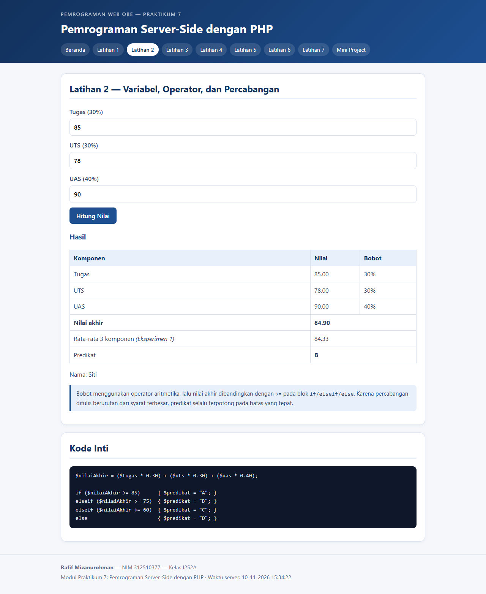

**Setelah nilai diubah lewat form (89,80 → predikat A, rata-rata 90,00):**

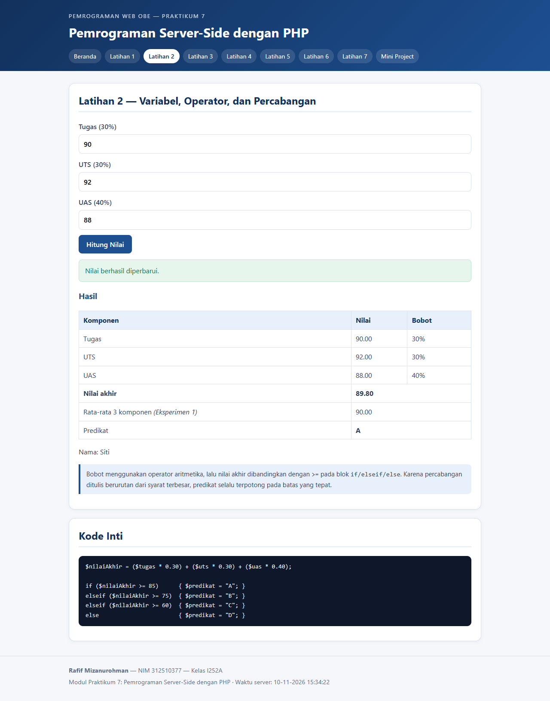

Input non-angka (mis. `abc`) ditolak pesan *"Nilai harus berupa angka 0–100"*.

### Latihan 3 — Perulangan dan Array

Array `$mahasiswa` berisi 7 nama (4 sesuai modul + 3 tambahan sesuai instruksi) dan seluruhnya
ditampilkan dengan `foreach` dalam bentuk daftar bernomor, tiap nama dibersihkan dengan
`htmlspecialchars()`.

```php
$mahasiswa = ["Alya", "Bima", "Citra", "Doni", "Eka", "Farhan", "Gita"];
foreach ($mahasiswa as $nama) {
    echo "<li>" . htmlspecialchars($nama) . "</li>";
}
```

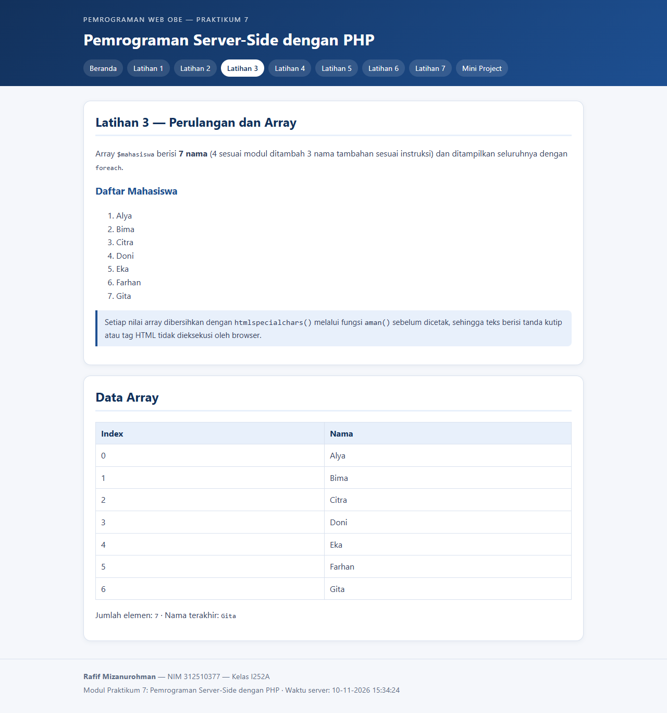

### Latihan 4 — Function

```php
function hitungDiskon($harga, $persen) {
    $potongan = $harga * ($persen / 100);
    return $harga - $potongan;
}
function hitungLuasPersegiPanjang($panjang, $lebar) { return $panjang * $lebar; }
function tentukanKelulusan($nilai) { return $nilai >= 75 ? "LULUS" : "TIDAK LULUS"; }
```

| Function | Pemanggilan | Hasil |
|---|---|---|
| `hitungDiskon()` | `hitungDiskon(150000, 10)` | Rp135.000 |
| `hitungDiskon()` | `hitungDiskon(250000, 25)` | Rp187.500 |
| `hitungLuasPersegiPanjang()` | `hitungLuasPersegiPanjang(8, 4)` | 32 |
| `tentukanKelulusan()` | `tentukanKelulusan(78)` | LULUS |
| `formatRupiah()` *(Eksperimen 3)* | `formatRupiah(150000)` | Rp150.000 |

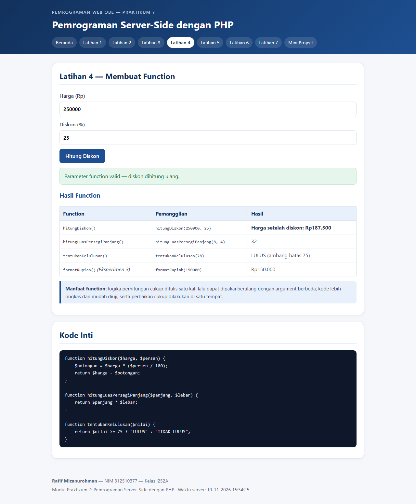

### Latihan 5 — Memproses Form dengan GET

Form memakai `method="GET"`, sehingga kata kunci muncul di URL (`?kata=a`) — halaman dapat
dibookmark/dibagikan. Karena data terekspos di URL, **GET tidak boleh dipakai untuk kata sandi**.
Ditambahkan pencarian nama dari array sederhana (Eksperimen 2).

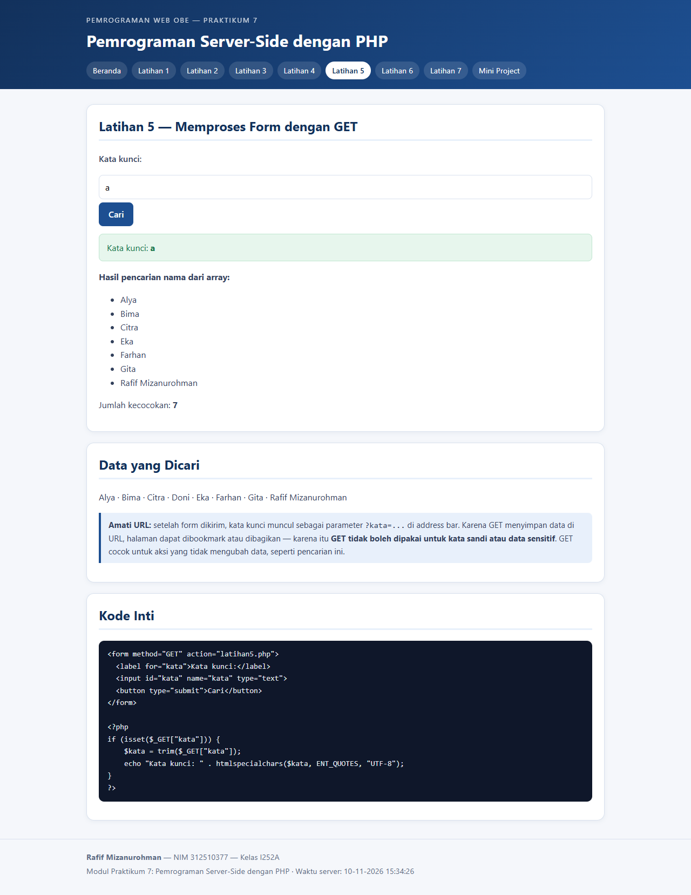

Pencarian `?kata=zzzz` menghasilkan pesan *"Tidak ada nama yang mengandung ..."*.

### Latihan 6 — Memproses Form dengan POST

```php
if ($_SERVER["REQUEST_METHOD"] === "POST") {
    $nama  = trim($_POST["nama"]  ?? "");
    $prodi = trim($_POST["prodi"] ?? "");
    if ($nama === "" || $prodi === "") {
        $error = "Semua kolom wajib diisi.";
    } else { /* tampilkan data */ }
}
```

**Kondisi tidak valid (kedua kolom kosong):**

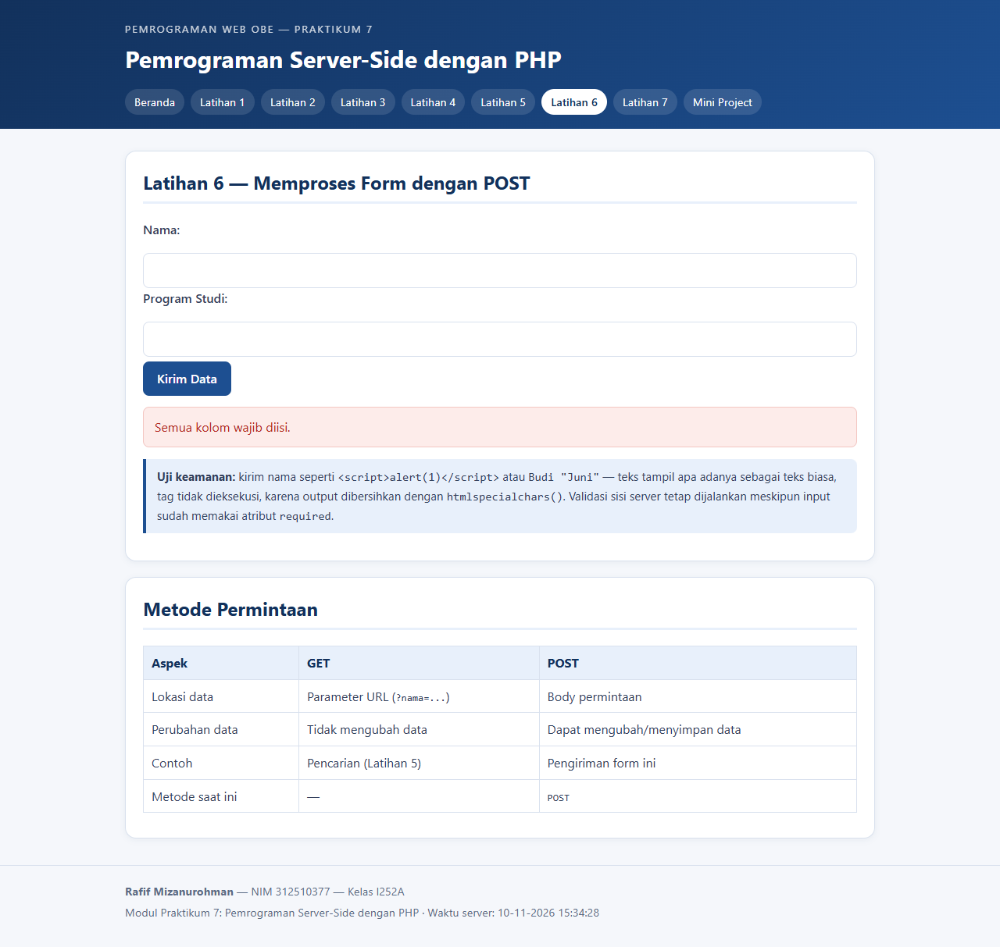

**Uji injeksi HTML** — input `Rafif "Mizanurohman" <script>alert(1)</script>` tampil sebagai teks
biasa, tag tidak dieksekusi karena output dibersihkan `htmlspecialchars()`:


**Kondisi valid:**

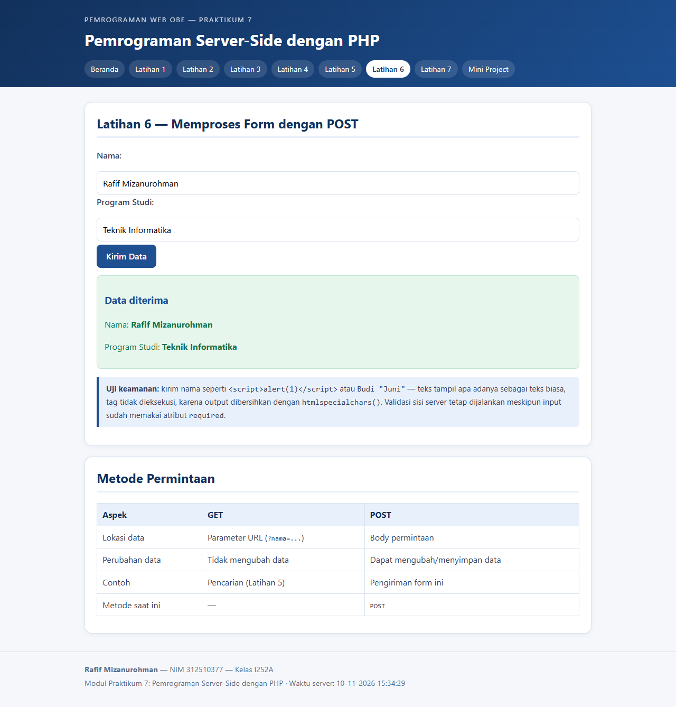

### Latihan 7 — Pengolahan Data Sederhana

Validasi server: nama wajib, harga numerik dan ≥ 0, jumlah hanya digit dan ≥ 1
(`ctype_digit()` menolak `-3` dan `1.5`), lalu subtotal dihitung PHP dan ditampilkan dalam format Rupiah.

| Barang | Harga | Jumlah | Hasil |
|---|---|---|---|
| Keyboard Mekanik | 450000 | 2 | Subtotal Rp900.000 |
| Mouse | 150000.50 | 1 | Subtotal Rp150.000,50 |
| Flashdisk | 50000 | 0 | Ditolak (jumlah ≥ 1) |
| Flashdisk | 50000 | -3 | Ditolak (`ctype_digit`) |
| (kosong) | abc | 1 | Ditolak (nama & harga) |

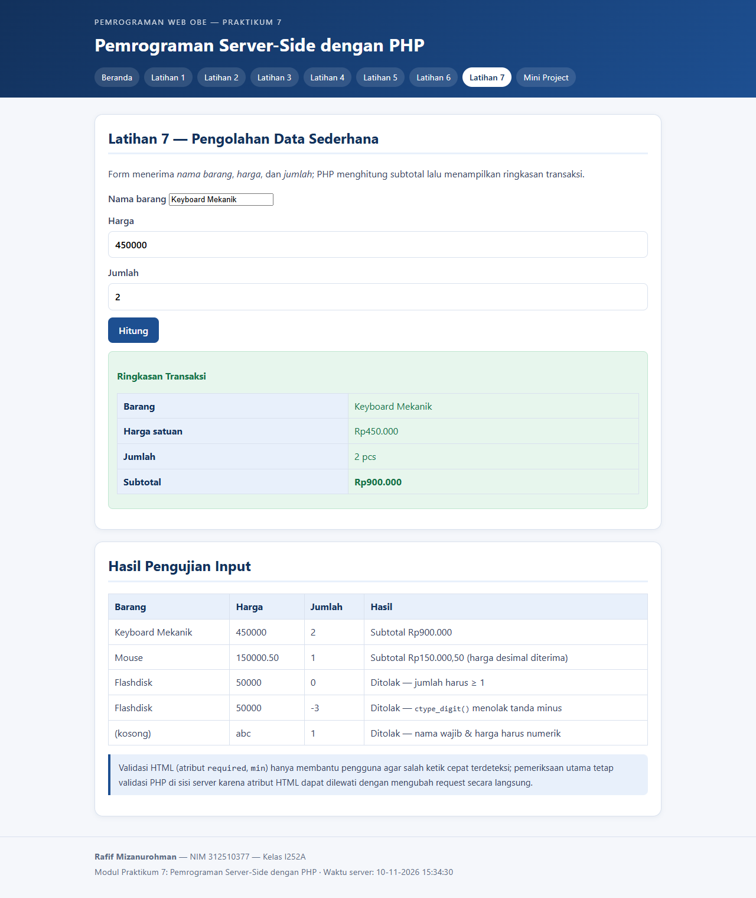

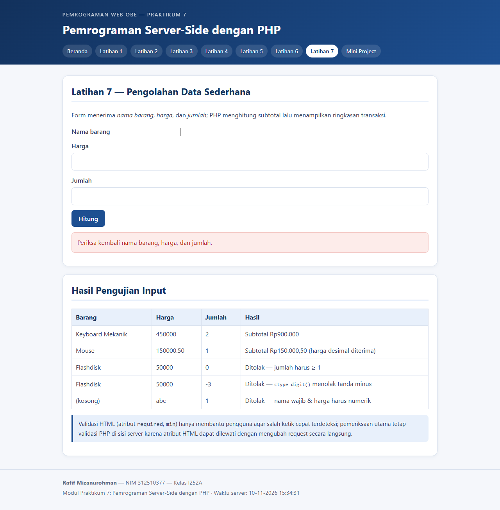

---

## Mini Project — Formulir Data Mahasiswa

Fitur:

1. Form berisi **nama, NIM, program studi, semester, email**, dikirim dengan **POST**.
2. **Validasi sisi server** seluruhnya di `proses_mahasiswa.php` (fungsi `prosesDataMahasiswa()`)
   — terpisah dari tampilan HTML `miniproject.php`, sesuai ketentuan modul.
3. Semua pesan kesalahan ditampilkan sekaligus; bila valid, muncul ringkasan data.
4. Output dibersihkan dengan `htmlspecialchars()` (fungsi `aman()`).
5. **Tombol Reset** (Eksperimen 5) pada form.

```php
// proses_mahasiswa.php — seluruh pemrosesan ada di sini
function prosesDataMahasiswa(array $input): array {
    ...
    if ($nama === "")                              $error[] = "Nama wajib diisi.";
    if ($nim === "" )                              $error[] = "NIM wajib diisi.";
    elseif (!ctype_digit($nim) || strlen($nim) !== 9)
                                                   $error[] = "NIM hanya boleh berisi angka dan panjangnya tepat 9 digit.";
    if (!filter_var($email, FILTER_VALIDATE_EMAIL)) $error[] = "Format email tidak valid.";
    if (!ctype_digit((string)$semesterInput) || (int)$semesterInput < 1 || (int)$semesterInput > 14)
                                                   $error[] = "Semester harus berupa angka 1–14.";
    ...
}
```

### Kasus input TIDAK VALID (4 pengujian)

| # | Kasus | Nama | NIM | Prodi | Semester | Email | Pesan yang tampil |
|---|---|---|---|---|---|---|---|
| 1 | Banyak kolom salah | *(kosong)* | `12AB34567` | *(kosong)* | *(kosong)* | `bukan-email` | 5 pesan error sekaligus: nama wajib, NIM 9 digit, prodi wajib, format email, semester 1–14 |
| 2 | Hanya NIM salah | Rafif Mizanurohman | `31251037A` | Teknik Informatika | 5 | `rafif@contoh.com` | NIM hanya boleh berisi angka dan panjangnya tepat 9 digit |
| 3 | Semester kosong & email salah | Rafif Mizanurohman | 312510377 | Teknik Informatika | *(kosong)* | `rafif.apel` | Semester harus berupa angka 1–14 + Format email tidak valid |
| 4 | NIM kurang dari 9 digit | Rafif Mizanurohman | `123` | Teknik Informatika | 5 | `rafif@contoh.com` | NIM hanya boleh berisi angka dan panjangnya tepat 9 digit |

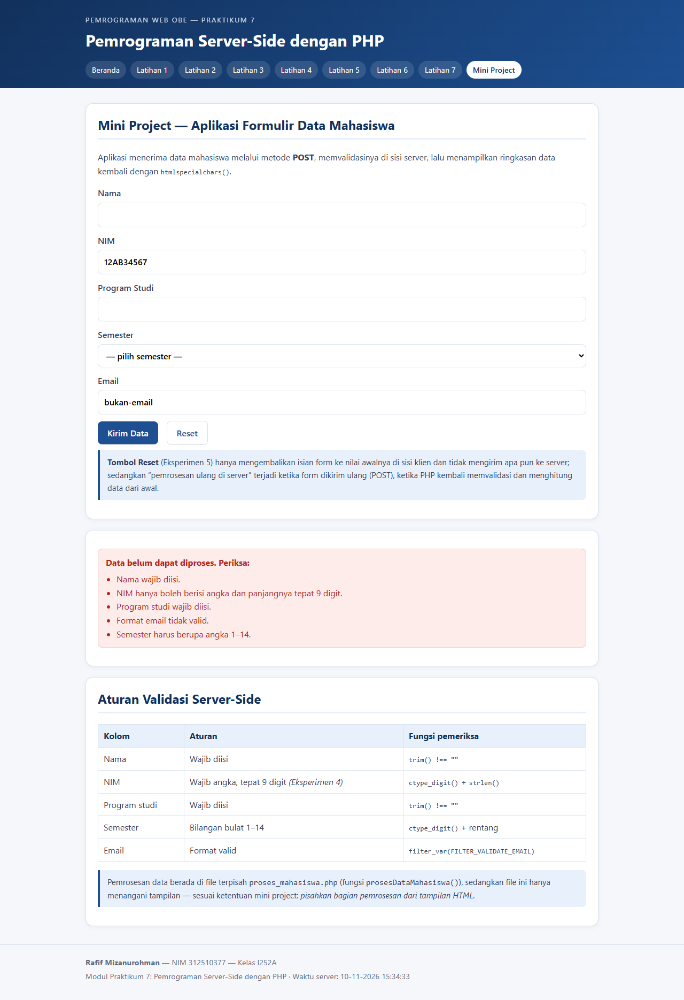

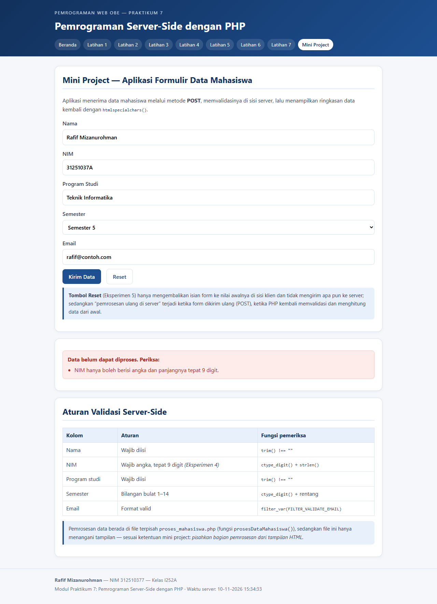

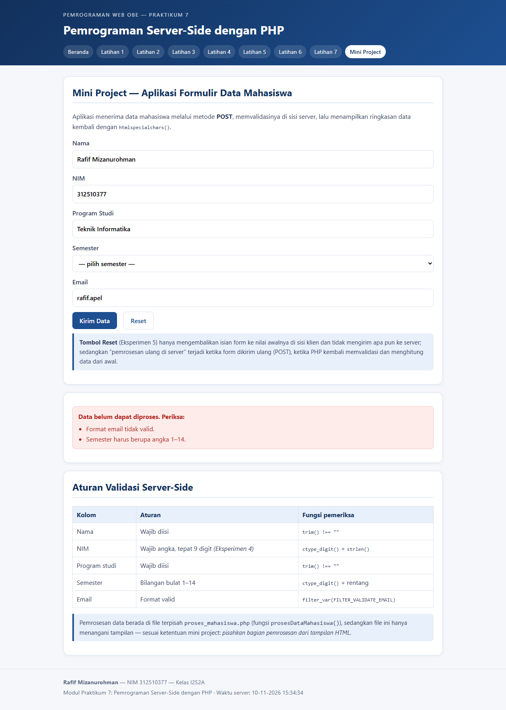

### Kasus input VALID (2 pengujian)

| # | Kasus | Nama | NIM | Prodi | Semester | Email | Hasil |
|---|---|---|---|---|---|---|---|
| 1 | Data lengkap & benar | Rafif Mizanurohman | 312510377 | Teknik Informatika | 5 | `rafif@contoh.com` | Ringkasan data mahasiswa tampil seluruhnya |
| 2 | Data kedua | Alya Rahmawati | 312510399 | Sistem Informasi | 2 | `alya@contoh.com` | Ringkasan data mahasiswa tampil seluruhnya |

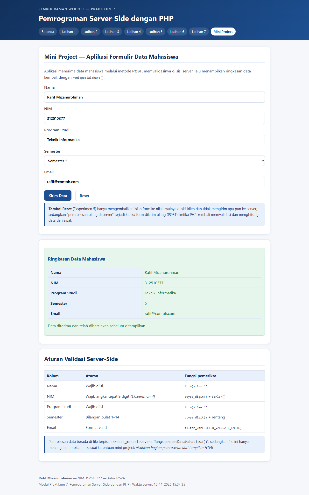

**Uji tombol Reset** (isian diisi lalu ditekan Reset → form kembali kosong, ringkasan tetap tidak
ada karena tidak ada request yang dikirim ke server):

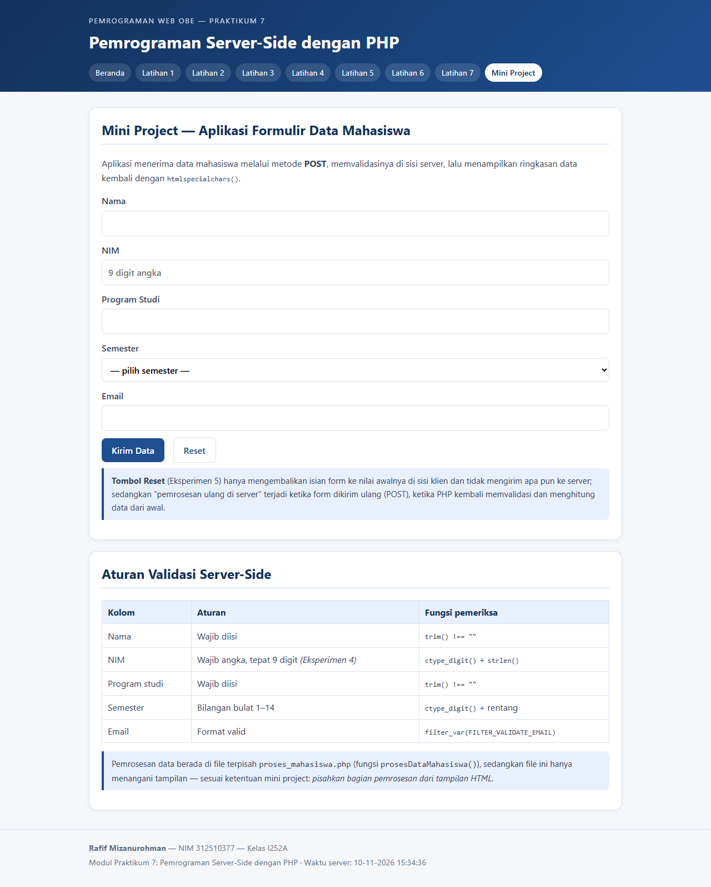

**Responsif di perangkat mobile (375 px):**

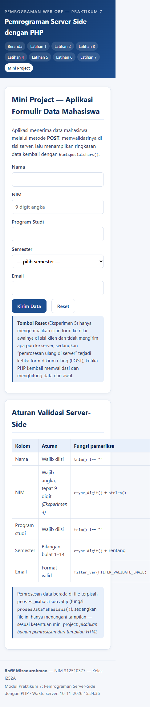

---

## Eksperimen Mandiri

| No | Eksperimen | Penerapan |
|---|---|---|
| 1 | Perhitungan nilai rata-rata dari tiga komponen nilai | `latihan2.php` — `$rataRata = ($tugas + $uts + $uas) / 3` |
| 2 | GET mencari nama dari array data sederhana | `latihan5.php` — pencarian `stripos()` pada `$daftarNama` |
| 3 | Function format harga menjadi Rupiah | `fungsi_bantu.php` → `formatRupiah()`, dipakai di Latihan 4 & 7 |
| 4 | NIM hanya angka dengan panjang yang ditentukan | `proses_mahasiswa.php` → `ctype_digit()` + `strlen() === 9` |
| 5 | Tombol reset vs pemrosesan ulang di server | Tombol `type="reset"` di `miniproject.php` + penjelasan pada halaman & README di bawah |

**Eksperimen 5 — perbedaan tombol Reset dan pemrosesan ulang di server**

| | Tombol Reset (`type="reset"`) | Pemrosesan ulang di server |
|---|---|---|
| Apa yang terjadi | Browser **mengembalikan isian form ke nilai awalnya** | Form dikirim ulang (POST), PHP berjalan lagi dari awal |
| Request ke server | **Tidak ada** request sama sekali | Selalu ada request POST baru |
| Validasi PHP | Tidak dijalankan | Dijalankan ulang terhadap data terkirim |
| Terlihat dari | Form bersih, tidak ada ringkasan baru | Halaman menampilkan hasil validasi/`Ringkasan Data Mahasiswa` |

---

## Hasil Pengujian Otomatis

Seluruh aplikasi diuji dengan browser headless (Playwright/Chromium) yang menjalankan interaksi
nyata seperti pengguna. Hasil: **60 pemeriksaan — 60 PASS, 0 gagal** (file `hasil_pengujian.txt`),
antara lain:

- Setiap halaman merespons **HTTP 200** dan tidak mengandung error PHP (`Fatal error`, `Parse error`, `Warning`).
- Latihan 1: output PHP muncul, waktu server tampil, kode `<?php` tidak bocor ke halaman.
- Latihan 2: nilai default 84,90; perubahan nilai → 89,80 dengan predikat A; rata-rata 90,00; input non-angka ditolak.
- Latihan 3: 7 elemen `<li>` tampil dari `foreach`.
- Latihan 4: diskon 10% → Rp135.000, diskon 25% → Rp187.500, luas 32, kelulusan LULUS, format Rupiah bekerja.
- Latihan 5: URL berubah menjadi `?kata=a`, hasil pencarian dari array tampil, kata kunci tanpa kecocokan ditangani.
- Latihan 6: form kosong ditolak; POST sukses; tag `<script>` tampil sebagai teks (anti-XSS).
- Latihan 7: subtotal Rp900.000; harga non-numerik ditolak.
- Mini Project: 5 pesan error pada kasus 1, NIM/salah semester/email ditolak, kasus valid menampilkan ringkasan, reset bekerja tanpa request ke server.
- Seluruh halaman berjalan **tanpa satu pun error JavaScript**.

---

## Jawaban Pertanyaan Evaluasi

### 1. Apa perbedaan pemrosesan client-side dan server-side?

**Client-side** dijalankan di browser pengguna (HTML, CSS, JavaScript): browser yang menghitung,
memvalidasi, dan mengubah tampilan. **Server-side** dijalankan di komputer server: server menerima
permintaan, memproses input, menjalankan aturan aplikasi (mis. menghitung subtotal, memvalidasi
form), lalu mengirimkan respons berupa HTML ke browser. Ciri PHP: kode `<?php ... ?>` tidak pernah
sampai ke browser — yang diterima browser adalah **hasil output** PHP berupa HTML.

### 2. Mengapa file PHP harus dijalankan melalui web server?

Karena PHP adalah bahasa **server-side**: kode PHP harus dieksekusi oleh interpreter PHP yang
dijalankan web server (Apache/Nginx/php built-in server). Jika file dibuka dengan klik ganda,
browser tidak memiliki interpreter PHP sehingga yang tampil adalah kode mentah (atau diunduh),
bukan hasil prosesnya. Selain itu, web server juga yang menangani `$_GET`, `$_POST`, dan
`$_SERVER["REQUEST_METHOD"]` yang dibutuhkan program.

### 3. Apa fungsi tanda `$` pada variabel PHP?

Tanda `$` adalah **penanda awal nama variabel** — semua nama variabel PHP ditulis dengan `$` di
depannya, mis. `$nama = "Siti";`. Tanpa `$`, PHP akan menafsirkannya sebagai teks literal atau
konstanta. Nama variabel juga bersifat **case-sensitive**, sehingga `$nama` berbeda dengan `$Nama`.

### 4. Apa perbedaan metode GET dan POST?

| Aspek | GET | POST |
|---|---|---|
| Lokasi data | Parameter URL (`?kata=a`) | Body permintaan |
| Terlihat di URL | Ya, bisa dibookmark/dibagikan | Tidak |
| Penggunaan | Permintaan yang **tidak mengubah data** (pencarian, filter) | Pengiriman form yang menyimpan/memproses data |
| Ukuran data | Terbatas oleh panjang URL | Tidak terbatas secara praktis |
| Keamanan | Data terekspos → **jangan untuk kata sandi** | Lebih tertutup, tetapi **bukan enkripsi** — tetap perlu HTTPS |

Pada praktikum ini: Latihan 5 memakai GET (pencarian), Latihan 6, 7, dan Mini Project memakai POST.

### 5. Mengapa input pengguna perlu divalidasi di sisi server?

Karena atribut validasi HTML (`required`, `min`, `type="email"`) hanya berjalan di browser dan
**bisa dilewati** — seseorang dapat mengubah halaman lewat DevTools atau mengirim request langsung
dengan curl/Postman. Server adalah pihak terakhir yang memegang data, sehingga pemeriksaan di server
(`trim()`, `ctype_digit()`, `filter_var()`, cek rentang) wajib ada agar data yang tersimpan/diproses
tetap benar dan program tidak mudah dimanipulasi.

### 6. Apa fungsi `htmlspecialchars()` ketika menampilkan data dari form?

`htmlspecialchars()` mengubah karakter khusus HTML menjadi entitas: `<` → `&lt;`, `>` → `&gt;`,
`"` → `&quot;`, `&` → `&amp;`. Dengan begitu teks pengguna tampil sebagai **teks biasa** dan tidak
ditafsirkan sebagai markup, sehingga mencegah **injeksi HTML/script (XSS)** — contohnya pada Latihan 6,
input `<script>alert(1)</script>` tampil literal tanpa dieksekusi browser.

### 7. Apa manfaat penggunaan function dalam program PHP?

1. **Modular** — logika (mis. `hitungDiskon()`, `formatRupiah()`) ditulis sekali dan dipakai
   berkali-kali dengan argument berbeda.
2. **Mengurangi duplikasi** dan memperkecil peluang salah ketik — perbaikan cukup di satu tempat.
3. **Mudah diuji dan dirawat** — fungsi punya tanggung jawab tunggal, lebih mudah di-debug.
4. **Membaca kode lebih jelas** — `tentukanKelulusan($nilai)` lebih informatif daripada blok
   `if` panjang yang diulang di beberapa tempat.

---

## Kesimpulan

Praktikum ini memperlihatkan bahwa PHP dieksekusi di sisi server: file `.php` harus diakses melalui
web server, dan yang sampai ke browser hanyalah HTML hasil proses PHP. Saya dapat menggunakan
variabel (`$`), tipe data, operator aritmatika, percabangan `if/elseif`, perulangan `foreach`, dan
function — termasuk function bantu `formatRupiah()` yang dipakai ulang di beberapa halaman. Form
HTML diproses dengan **GET** untuk pencarian (data tampil di URL) dan **POST** untuk pengiriman data.
Validasi selalu dilakukan di server (`trim()`, `ctype_digit()`, `filter_var()`, cek rentang) karena
validasi HTML bisa dilewati, dan setiap output pengguna dibersihkan dengan `htmlspecialchars()` agar
aman dari XSS. Pada Mini Project, logika pemrosesan dipisahkan ke `proses_mahasiswa.php` sehingga
alur program lebih rapi. Seluruh pengujian otomatis berjalan **60/60 PASS** tanpa error PHP maupun
JavaScript.
